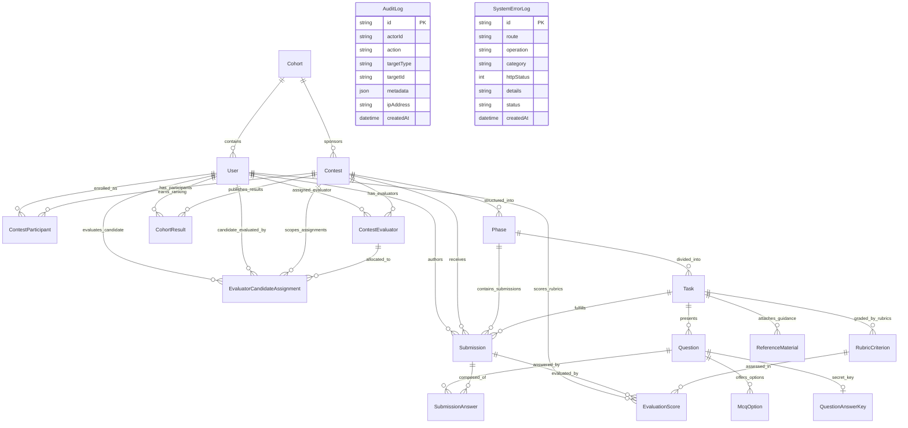

# EDGE-Arena: Comprehensive Architectural, Database Schema & Codebase Audit

**Document Version:** 1.0.0  
**Audit Date:** October 2026  
**Target Platform:** EDGE-Arena / ACI Career EDGE Assess  
**Status:** Certified Read-Only Audit & Inventory Report  

---

## Executive Summary

EDGE-Arena is an enterprise contest, evaluation, and assessment orchestration platform engineered for the **ACI Career EDGE Academy / Campus Leadership Programme (CLP)**. The platform provides end-to-end multi-phase contest administration, automated MCQ evaluation, criterion-referenced rubric grading for essays and PDF submissions, evaluator-to-candidate allocation, proctored monitoring with telemetry event tracking, immutable audit logging, and certified leaderboard publication with tie-breaking logic.

This audit report provides an exhaustive, definitive analysis of the complete application architecture, database schema, data relationships, business workflows, file inventory, production readiness, and technical debt.

---

## Table of Contents

1. [Section 1: Project Architecture](#section-1-project-architecture)
   - 1.1 Technology Stack & Installed Dependencies
   - 1.2 Directory Structure & Organization
   - 1.3 Next.js Routing Architecture
   - 1.4 Shared Layouts, Components & Middleware
   - 1.5 Server Actions & API Streaming Architecture
   - 1.6 File Upload & Document Access Architecture
   - 1.7 Environment Variables & External Services
2. [Section 2: Complete Database Schema](#section-2-complete-database-schema)
   - 2.1 Verbatim `prisma/schema.prisma`
   - 2.2 Prisma Models, Enums, Cascades & Index Inventory
   - 2.3 Entity-Relationship Diagram (Mermaid)
   - 2.4 Model Purpose & Relationship Matrix
   - 2.5 Migration History & Verification
   - 2.6 Domain Grouping of Database Models
   - 2.7 Scoring, Penalties & Leaderboard Mathematics
3. [Section 3: Important Business Logic & Core Workflows](#section-3-important-business-logic--core-workflows)
   - 3.1 Admin Authentication & Provisioning
   - 3.2 Contest Creation & Lifecycle Management
   - 3.3 Phase, Task & Question Curriculum Authoring
   - 3.4 Participant Enrollment & Sequential Progression
   - 3.5 Answer Saving, File Uploads & Final Task Submission
   - 3.6 Evaluator-to-Contest & Evaluator-to-Candidate Allocation
   - 3.7 Automatic MCQ Grading & Evaluator Rubric Grading
   - 3.8 Monitoring Telemetry, Permissions & Penalties
   - 3.9 Result Finalization, Publication & Leaderboard Ranking
   - 3.10 Error Handling, Audit Logging & Access Control
4. [Section 4: File and Dependency Inventory](#section-4-file-and-dependency-inventory)
   - 4.1 Essential Runtime Files
   - 4.2 Business Logic & Server Actions
   - 4.3 Database Schema, Migrations & Provisioning Scripts
   - 4.4 Automated Test Suite
   - 4.5 Development & Benchmarking Tools
   - 4.6 Potentially Redundant & Cleanup Candidates (Detailed Risk Analysis)
   - 4.7 Generated Artifacts & Build Outputs
   - 4.8 Uncertain Files
5. [Section 5: Configuration & Production Deployment](#section-5-configuration--production-deployment)
   - 5.1 CLI Commands (Dev, Build, Lint, Test, Seed, Migrate)
   - 5.2 Authentication & Session Architecture
   - 5.3 Database Migration & Bootstrap Procedures
   - 5.4 Environment Variable Reference Table
   - 5.5 Production vs. Development Runtime Differences
6. [Section 6: Known Risks and Technical Debt](#section-6-known-risks-and-technical-debt)
   - 6.1 Architectural & Deprecation Warnings
   - 6.2 Data Model & Invariant Risks
   - 6.3 Security & Boundary Observations
   - 6.4 Proposed Prioritized Cleanup Plan

---

# Section 1: Project Architecture

### 1.1 Technology Stack & Installed Dependencies

The platform is constructed on modern full-stack TypeScript using the Next.js App Router framework:

- **Framework & Core Runtime:**
  - Next.js 16.4.1 (Turbopack, App Router, React Server Components & Server Actions)
  - React 19.3.0 & React DOM 19.3.0
  - TypeScript 5.9.3 (Strict mode, ES2022 target)
  - Node.js 20+ runtime
- **Data Persistence & Modeling:**
  - Prisma ORM 6.4.1 (`@prisma/client` and `prisma` CLI)
  - PostgreSQL hosted on Supabase (`aws-0-ap-south-1.pooler.supabase.com:5432`)
  - Connection pooling via Supabase PgBouncer / transaction pooler (`DATABASE_URL`) with direct TCP fallback (`DIRECT_URL`)
- **Styling & UI Components:**
  - Tailwind CSS 4.x (`tailwindcss` and `@tailwindcss/turbopack`)
  - `lucide-react` 1.57.0 (Iconography)
  - `clsx` 2.1.1 and `tailwind-merge` 3.7.0 (Dynamic class utilities)
  - `class-variance-authority` 0.7.1
- **Storage & Cloud Infrastructure:**
  - Cloudflare R2 (S3-compatible object storage via native HTTP streaming / `@aws-sdk/client-s3`)
  - Supabase Storage (Enterprise cloud private bucket fallback)
- **Security & Cryptography:**
  - Node.js native `crypto.scryptSync` (N=16384, r=8, p=1, 64-byte key) with 16-byte random salt
  - Web Crypto API (`crypto.subtle`) for HMAC-SHA256 session token signing and verification
  - Timing-safe password verification via `crypto.timingSafeEqual`
- **Testing & Execution:**
  - Node.js native test runner (`node:test`, `node:assert/strict`) via `tsx` (4.23.15)
  - ESLint 9 (`eslint-config-next`)

---

### 1.2 Directory Structure & Organization

```
d:\ACI\stitch_aci_career_edge_assess_ui_ux_platform\
├── .env                              # Active environment configuration (git-ignored)
├── .env.example                      # Production template with redacted credentials
├── .gitignore                        # Git ignore rules
├── AGENTS.md                         # Next.js 16 development rules & boundaries
├── components.json                   # UI configuration descriptor
├── eslint.config.mjs                 # Flat ESLint 9 configuration
├── next.config.ts                    # Next.js server configuration
├── package.json                      # NPM package manifest & scripts
├── README.md                         # Repository overview
├── tsconfig.json                     # TypeScript strict configuration
│
├── prisma/                           # Database domain
│   ├── migrations/                   # Applied PostgreSQL migration history
│   │   ├── 20260228000000_baseline_schema_and_security/
│   │   ├── 20261027210000_secure_auth_and_system_error_log/
│   │   ├── 20261027220000_evaluator_contest_allocation/
│   │   └── migration_lock.toml
│   ├── rls-policies.sql              # Supabase Row Level Security & trigger policies
│   ├── schema.prisma                 # Primary database schema definition (16 models)
│   └── seed-demo.ts                  # Development cohort and user seeding script
│
├── scripts/                          # Operational & provisioning tools
│   └── provision-admin.ts            # Idempotent platform administrator provisioning CLI
│
├── src/
│   ├── instrumentation.ts            # Next.js server boot hook (aborted client request handler)
│   ├── middleware.ts                 # Role-based route guard and password-change interceptor
│   │
│   ├── app/                          # Next.js App Router root
│   │   ├── favicon.ico
│   │   ├── globals.css               # Core CSS & Tailwind theme directives
│   │   ├── layout.tsx                # Universal root HTML/body shell
│   │   ├── page.tsx                  # Landing page redirector
│   │   ├── change-password/          # Forced temporary password rotation interface
│   │   ├── login/                    # Universal authentication portal
│   │   ├── unauthorized/             # Role boundary error page
│   │   │
│   │   ├── actions/                  # 13 Server Action domain modules
│   │   │   ├── assessment-actions.ts           # Participant task loader, auto-save, submission & next-task resolver
│   │   │   ├── auth-actions.ts                 # Login, logout, session state & password change
│   │   │   ├── contest-actions.ts              # Admin contest CRUD, lifecycle & status switches
│   │   │   ├── evaluator-actions.ts            # Evaluator grading workbench, rubric scores & publish action
│   │   │   ├── evaluator-allocation-actions.ts # Evaluator-to-contest & candidate assignment logic
│   │   │   ├── evaluator-management-actions.ts # Admin evaluator account creation & listing
│   │   │   ├── file-actions.ts                 # File uploads, buffer validation & signed downloads
│   │   │   ├── monitoring-actions.ts           # Proctoring events, penalty deduction & screenshot telemetry
│   │   │   ├── participant-actions.ts          # Admin candidate management & CSV batch enrollment
│   │   │   ├── participant-nav-actions.ts      # Participant contest tree, scorecard & published results
│   │   │   ├── results-actions.ts              # Result publishing query, leaderboard computation & audit logs
│   │   │   ├── system-error-actions.ts         # Persistent error logging & diagnostics viewer
│   │   │   └── task-builder-actions.ts         # Admin curriculum authoring (phases, tasks, questions, rubrics)
│   │   │
│   │   ├── admin/                    # Platform Administrator portal
│   │   │   ├── layout.tsx            # Admin layout with sidebar, header & contest context
│   │   │   ├── page.tsx              # Executive operational overview & metrics
│   │   │   ├── audit/page.tsx        # Immutable audit log inspection table
│   │   │   ├── contests/page.tsx     # Contest lifecycle manager & evaluator allocation
│   │   │   ├── errors/page.tsx       # System error log diagnostics console
│   │   │   ├── evaluators/page.tsx   # Evaluator account management & status controls
│   │   │   ├── monitoring/page.tsx   # Real-time contest telemetry & penalty enforcement
│   │   │   ├── participants/page.tsx # Candidate roster & CSV batch enrollment
│   │   │   ├── results/page.tsx      # Publication console, scorecard viewer & certified leaderboard
│   │   │   ├── submissions/page.tsx  # Central submission ledger & grading status monitor
│   │   │   └── tasks/page.tsx        # Curriculum builder (phases, tasks, questions, keys)
│   │   │
│   │   ├── api/                      # Route handlers
│   │   │   └── files/[...fileKey]/route.ts  # Secure streaming endpoint for PDF submissions & references
│   │   │
│   │   ├── assessment/               # Candidate assessment execution environment
│   │   │   ├── page.tsx              # Query-parameter fallback interface (`?contestId=...&taskId=...`)
│   │   │   └── [contestId]/[phaseId]/[taskId]/page.tsx # Canonical deep-link assessment reader
│   │   │
│   │   ├── dashboard/                # Participant portal
│   │   │   ├── layout.tsx            # Participant shell with header, sidebar & navigation
│   │   │   ├── page.tsx              # Candidate home dashboard (enrolled contests, stats)
│   │   │   ├── contests/page.tsx     # Enrolled contest catalog
│   │   │   ├── contests/[id]/page.tsx# Contest overview, phases & task list
│   │   │   ├── leaderboard/page.tsx  # Published leaderboard & certified ranking
│   │   │   ├── profile/page.tsx      # Candidate profile & credential status
│   │   │   └── results/page.tsx      # Personal published scorecard & feedback breakdown
│   │   │
│   │   └── evaluator/                # Academic evaluator grading workbench
│   │       ├── page.tsx              # Assigned submissions evaluation workbench & rubric scoring
│   │       └── monitoring/page.tsx   # Evaluator proctoring view
│   │
│   ├── components/                   # Reusable React components
│   │   ├── admin/
│   │   │   └── evaluator-allocation-panel.tsx  # Evaluator assignment modal
│   │   ├── assessment/
│   │   │   └── assessment-document-reader.tsx  # Document reader, editor, MCQ picker, timer & progression
│   │   ├── layout/
│   │   │   ├── admin-header.tsx
│   │   │   ├── admin-sidebar.tsx
│   │   │   ├── participant-footer.tsx
│   │   │   ├── participant-header.tsx
│   │   │   └── participant-sidebar.tsx
│   │   ├── modals/
│   │   │   └── delete-confirmation-modal.tsx   # Destructive action confirmation dialog
│   │   ├── monitoring/
│   │   │   └── monitoring-dashboard-view.tsx   # Proctoring telemetry table & live penalty controls
│   │   └── ui/
│   │       └── brand-logo.tsx                  # ACI Career EDGE logo
│   │
│   ├── context/
│   │   └── admin-contest-context.tsx           # React Context for synchronized contest filtering in Admin
│   │
│   ├── hooks/
│   │   └── use-contest-timer.ts                # Real-time countdown timer & Dhaka timezone formatter
│   │
│   ├── lib/                          # Domain business logic & utilities
│   │   ├── audit.ts                  # Persistent audit logging helper (`recordAuditLog`)
│   │   ├── auth.ts                   # HMAC session token signing, cookie storage, `requireRole`
│   │   ├── contest-lifecycle.ts      # Contest & Phase status transitions, conclusion verification
│   │   ├── credentials.ts            # Scrypt password hashing, verification, password complexity
│   │   ├── demo-data.ts              # [CLEANUP CANDIDATE] Static mock benchmarks (unimported)
│   │   ├── error-logger.ts           # Error sanitization, correlation IDs (`ERR-XXXXXXXX`), DB logger
│   │   ├── monitoring.ts             # Proctoring configuration, telemetry queries, penalty calculator
│   │   ├── prisma.ts                 # Global PrismaClient singleton
│   │   ├── rate-limiter.ts           # In-memory sliding window rate limiter (brute-force defense)
│   │   ├── scoring.ts                # Auto-grading, weighted rubrics, answer sanitization
│   │   ├── storage.ts                # Cloudflare R2 / Supabase Storage driver & PDF validator
│   │   └── utils.ts                  # Tailwind `cn()` helper
│   │
│   └── test/                         # Comprehensive automated test suite
│       ├── admin-contest-filtering-and-production-readiness.test.ts
│       ├── csv-enrollment.test.ts
│       ├── database-logic.test.ts
│       ├── document-reader-and-deadline.test.ts
│       ├── end-to-end-flow.test.ts
│       ├── ensure-pilot-contest.ts   # Shared test fixture provisioning helper
│       ├── evaluator-allocation-authorization.test.ts
│       ├── evaluator-grading.test.ts
│       ├── file-storage.test.ts
│       ├── final-submission-penalties-evidence.test.ts
│       ├── full-assessment-lifecycle-2027.test.ts
│       ├── lifecycle-consistency.test.ts
│       ├── mac-phase-progression-and-pdf.test.ts
│       ├── monitoring-and-accounts.test.ts
│       ├── multi-task-navigation.test.ts
│       ├── navigation-and-panels.test.ts
│       ├── perf-benchmark.ts         # Standalone query performance benchmark script
│       ├── phase-progression-and-publication-workflow.test.ts
│       ├── role-auth.test.ts
│       ├── security-auth-admin.test.ts
│       └── workflow-progression-gate.test.ts
```

---

### 1.3 Next.js Routing Architecture

The application enforces strict separation between user roles via URL structure and Next.js middleware:

| Route Path | Allowed Roles | Description | Page Component |
| :--- | :--- | :--- | :--- |
| `/` | Public / Redirect | Evaluates session: unauthenticated redirects to `/login`; authenticated redirects to role dashboard | [`src/app/page.tsx`](file:///d:/ACI/stitch_aci_career_edge_assess_ui_ux_platform/src/app/page.tsx) |
| `/login` | Public / Unauthenticated | Single portal for email/password authentication across all roles. Auto-redirects if already logged in | [`src/app/login/page.tsx`](file:///d:/ACI/stitch_aci_career_edge_assess_ui_ux_platform/src/app/login/page.tsx) |
| `/change-password` | Authenticated (Must Change) | Enforced mandatory screen for accounts with `mustChangePassword: true` | [`src/app/change-password/page.tsx`](file:///d:/ACI/stitch_aci_career_edge_assess_ui_ux_platform/src/app/change-password/page.tsx) |
| `/unauthorized` | Authenticated | Generic boundary page displayed when accessing a route outside the user's role | [`src/app/unauthorized/page.tsx`](file:///d:/ACI/stitch_aci_career_edge_assess_ui_ux_platform/src/app/unauthorized/page.tsx) |
| `/admin` | `ADMIN` strictly | Platform operational overview, metrics, contest summary | [`src/app/admin/page.tsx`](file:///d:/ACI/stitch_aci_career_edge_assess_ui_ux_platform/src/app/admin/page.tsx) |
| `/admin/contests` | `ADMIN` strictly | Contest lifecycle manager, create/edit contest, evaluator allocation modal | [`src/app/admin/contests/page.tsx`](file:///d:/ACI/stitch_aci_career_edge_assess_ui_ux_platform/src/app/admin/contests/page.tsx) |
| `/admin/tasks` | `ADMIN` strictly | Curriculum builder: phases, tasks, questions, MCQ keys, rubrics, reference materials | [`src/app/admin/tasks/page.tsx`](file:///d:/ACI/stitch_aci_career_edge_assess_ui_ux_platform/src/app/admin/tasks/page.tsx) |
| `/admin/participants` | `ADMIN` strictly | Participant roster, single enrollment, CSV bulk batch enrollment | [`src/app/admin/participants/page.tsx`](file:///d:/ACI/stitch_aci_career_edge_assess_ui_ux_platform/src/app/admin/participants/page.tsx) |
| `/admin/evaluators` | `ADMIN` strictly | Evaluator directory, evaluator account creation, active status switches | [`src/app/admin/evaluators/page.tsx`](file:///d:/ACI/stitch_aci_career_edge_assess_ui_ux_platform/src/app/admin/evaluators/page.tsx) |
| `/admin/submissions` | `ADMIN` strictly | Global submission ledger, grading progress, candidate submission status | [`src/app/admin/submissions/page.tsx`](file:///d:/ACI/stitch_aci_career_edge_assess_ui_ux_platform/src/app/admin/submissions/page.tsx) |
| `/admin/results` | `ADMIN` strictly | Official results publisher, certified leaderboard generator, scorecards | [`src/app/admin/results/page.tsx`](file:///d:/ACI/stitch_aci_career_edge_assess_ui_ux_platform/src/app/admin/results/page.tsx) |
| `/admin/monitoring` | `ADMIN` strictly | Real-time proctoring telemetry, alert log, manual penalty deduction | [`src/app/admin/monitoring/page.tsx`](file:///d:/ACI/stitch_aci_career_edge_assess_ui_ux_platform/src/app/admin/monitoring/page.tsx) |
| `/admin/audit` | `ADMIN` strictly | Immutable audit trail of administrative actions | [`src/app/admin/audit/page.tsx`](file:///d:/ACI/stitch_aci_career_edge_assess_ui_ux_platform/src/app/admin/audit/page.tsx) |
| `/admin/errors` | `ADMIN` strictly | System error log diagnostics and correlation ID resolution | [`src/app/admin/errors/page.tsx`](file:///d:/ACI/stitch_aci_career_edge_assess_ui_ux_platform/src/app/admin/errors/page.tsx) |
| `/evaluator` | `EVALUATOR` (or `ADMIN` with audit flag) | Grading workbench: view assigned candidates, score rubrics, finalize grading | [`src/app/evaluator/page.tsx`](file:///d:/ACI/stitch_aci_career_edge_assess_ui_ux_platform/src/app/evaluator/page.tsx) |
| `/evaluator/monitoring` | `EVALUATOR` (or `ADMIN` with audit flag) | Evaluator proctoring view for assigned candidates | [`src/app/evaluator/monitoring/page.tsx`](file:///d:/ACI/stitch_aci_career_edge_assess_ui_ux_platform/src/app/evaluator/monitoring/page.tsx) |
| `/dashboard` | `PARTICIPANT` strictly | Candidate dashboard: enrolled contests, quick actions, overall stats | [`src/app/dashboard/page.tsx`](file:///d:/ACI/stitch_aci_career_edge_assess_ui_ux_platform/src/app/dashboard/page.tsx) |
| `/dashboard/contests` | `PARTICIPANT` strictly | Enrolled contest catalog | [`src/app/dashboard/contests/page.tsx`](file:///d:/ACI/stitch_aci_career_edge_assess_ui_ux_platform/src/app/dashboard/contests/page.tsx) |
| `/dashboard/contests/[id]` | `PARTICIPANT` strictly | Contest details, phase countdown, task status, entry point to assessment | [`src/app/dashboard/contests/[id]/page.tsx`](file:///d:/ACI/stitch_aci_career_edge_assess_ui_ux_platform/src/app/dashboard/contests/[id]/page.tsx) |
| `/dashboard/results` | `PARTICIPANT` strictly | Published personal scorecard, task-by-task scores, evaluator feedback | [`src/app/dashboard/results/page.tsx`](file:///d:/ACI/stitch_aci_career_edge_assess_ui_ux_platform/src/app/dashboard/results/page.tsx) |
| `/dashboard/leaderboard` | `PARTICIPANT` strictly | Certified published contest leaderboard with rank and percentile | [`src/app/dashboard/leaderboard/page.tsx`](file:///d:/ACI/stitch_aci_career_edge_assess_ui_ux_platform/src/app/dashboard/leaderboard/page.tsx) |
| `/dashboard/profile` | `PARTICIPANT` strictly | Candidate institutional details and security info | [`src/app/dashboard/profile/page.tsx`](file:///d:/ACI/stitch_aci_career_edge_assess_ui_ux_platform/src/app/dashboard/profile/page.tsx) |
| `/assessment/[contestId]/[phaseId]/[taskId]` | `PARTICIPANT` strictly | Fullscreen candidate assessment workspace: document reader, MCQ picker, essay editor, PDF uploader | [`src/app/assessment/[contestId]/[phaseId]/[taskId]/page.tsx`](file:///d:/ACI/stitch_aci_career_edge_assess_ui_ux_platform/src/app/assessment/[contestId]/[phaseId]/[taskId]/page.tsx) |
| `/assessment` | `PARTICIPANT` strictly | Query-param based fallback for `/assessment?contestId=...&taskId=...` | [`src/app/assessment/page.tsx`](file:///d:/ACI/stitch_aci_career_edge_assess_ui_ux_platform/src/app/assessment/page.tsx) |
| `/api/files/[...fileKey]` | Authenticated (Role/Ownership enforced) | Streamed download for submission PDFs and reference materials | [`src/app/api/files/[...fileKey]/route.ts`](file:///d:/ACI/stitch_aci_career_edge_assess_ui_ux_platform/src/app/api/files/[...fileKey]/route.ts) |

---

### 1.4 Shared Layouts, Components & Middleware

#### Middleware Security Architecture
Located at [`src/middleware.ts`](file:///d:/ACI/stitch_aci_career_edge_assess_ui_ux_platform/src/middleware.ts), the middleware acts as the primary perimeter defense:
1. **Benign Request Filtering:** Rejects already-aborted requests (`499 Client Closed Request`) to prevent unhandled socket reset exceptions.
2. **Mandatory Password Rotation Interception:** If a user possesses a valid session token where `mustChangePassword === true`, any attempt to navigate to protected routes is intercepted and rewritten to `/change-password`.
3. **Authentication Boundary:** Inspects the signed `edge_session` cookie via Web Crypto HMAC-SHA256. Unauthenticated requests targeting `/admin/*`, `/evaluator/*`, `/dashboard/*`, or `/assessment/*` are redirected to `/login?redirect=<target>`.
4. **Role Segregation:**
   - `/admin/*` requires `session.role === "ADMIN"`.
   - `/evaluator/*` requires `session.role === "EVALUATOR"` (or `ADMIN` with `?adminAudit=true`).
   - `/dashboard/*` and `/assessment/*` require `session.role === "PARTICIPANT"`.
   - Breaches redirect to `/unauthorized?required=<ROLE>&current=<ROLE>`.

#### Shared Layouts & UI Components
- **Admin Layout ([`src/app/admin/layout.tsx`](file:///d:/ACI/stitch_aci_career_edge_assess_ui_ux_platform/src/app/admin/layout.tsx)):** Wraps all admin routes inside `AdminContestProvider` ([`src/context/admin-contest-context.tsx`](file:///d:/ACI/stitch_aci_career_edge_assess_ui_ux_platform/src/context/admin-contest-context.tsx)), synchronizing the currently selected contest across sidebar navigation, header badges, and management panels.
- **Participant Layout ([`src/app/dashboard/layout.tsx`](file:///d:/ACI/stitch_aci_career_edge_assess_ui_ux_platform/src/app/dashboard/layout.tsx)):** Provides persistent top header navigation, responsive sidebar, contest switcher, and footer.
- **Assessment Document Reader ([`src/components/assessment/assessment-document-reader.tsx`](file:///d:/ACI/stitch_aci_career_edge_assess_ui_ux_platform/src/components/assessment/assessment-document-reader.tsx)):** High-density split-screen workspace offering:
  - Phase and task navigation sidebar with completion badges.
  - Interactive reference PDF reader embedded alongside question prompts.
  - MCQ radio-selection interface with real-time selection persistence.
  - Written essay text area with real-time word-count calculation against min/max constraints.
  - Drag-and-drop PDF upload dropzone with client and server validation.
  - Real-time countdown timer bound to the authoritative phase deadline via [`src/hooks/use-contest-timer.ts`](file:///d:/ACI/stitch_aci_career_edge_assess_ui_ux_platform/src/hooks/use-contest-timer.ts).
  - Background auto-save every 30 seconds.
  - Authoritative multi-task progression handling.

---

### 1.5 Server Actions & API Streaming Architecture

The platform uses Next.js Server Actions (`"use server"`) as its primary mutation and query pipeline, eliminating the need for boilerplate REST controllers while maintaining strict server-side validation:

```
[Browser Client]
       │
       ▼ (Server Action Call via POST)
[src/app/actions/*.ts]
       │
       ├─► 1. requireRole(["ADMIN" | "EVALUATOR" | "PARTICIPANT"]) via HMAC session
       ├─► 2. Validate input payloads & enforce server-side business rules
       ├─► 3. Execute database transactions via PrismaClient singleton
       ├─► 4. Record immutable AuditLog / SystemErrorLog entry
       ├─► 5. Sanitize outgoing responses (strip answer keys & unfinalized scores)
       │
       ▼
[PostgreSQL Database (Supabase)]
```

#### Secure File Streaming Route
Located at [`src/app/api/files/[...fileKey]/route.ts`](file:///d:/ACI/stitch_aci_career_edge_assess_ui_ux_platform/src/app/api/files/[...fileKey]/route.ts), this route handles binary document delivery:
- Does not expose public bucket URLs or presigned links to the client.
- Evaluates the user's role and database record ownership before streaming:
  - **Participant:** Can only stream files linked to their own `SubmissionAnswer` records.
  - **Evaluator:** Can only stream submission files for candidates assigned to them in `EvaluatorCandidateAssignment`.
  - **Admin:** Has global inspection access.
- Streams the raw binary Buffer directly with `Content-Type: application/pdf` and `Content-Disposition: inline`.

---

### 1.6 File Upload & Document Access Architecture

The storage subsystem in [`src/lib/storage.ts`](file:///d:/ACI/stitch_aci_career_edge_assess_ui_ux_platform/src/lib/storage.ts) provides enterprise-grade object storage with dual-driver support:

1. **Storage Drivers:**
   - **Cloudflare R2:** Primary S3-compatible driver activated when `R2_ACCESS_KEY_ID`, `R2_SECRET_ACCESS_KEY`, and `R2_ACCOUNT_ID` are provisioned.
   - **Supabase Storage:** Direct private bucket fallback using Supabase REST APIs via `NEXT_PUBLIC_SUPABASE_URL` and `SUPABASE_SERVICE_ROLE_KEY`.
2. **Server-Side Security Policies:**
   - Maximum upload limit: 25 MB (`MAX_UPLOAD_SIZE_BYTES = 25 * 1024 * 1024`).
   - Allowed extension: strictly `.pdf`.
   - Declared MIME type: strictly `application/pdf`.
   - **Magic Byte Verification:** Inspects the first 4 bytes of the binary buffer to verify standard `%PDF` header (`0x25 0x50 0x44 0x46`), blocking disguised executables.
   - **Cryptographic Checksum:** Calculates SHA-256 hash (`fileSha256`) of the file buffer and persists it on the `SubmissionAnswer` record for data integrity.
   - **Collision-Resistant Keys:** Object keys are generated server-side using timestamps and UUIDs (e.g. `submissions/<contestId>/<userId>/<randomUUID>.pdf`), ensuring user-supplied filenames cannot overwrite existing files or execute path traversal attacks.

---

### 1.7 Environment Variables & External Services

| Variable Name | Required Scope | Architectural Purpose |
| :--- | :--- | :--- |
| `DATABASE_URL` | Production & Dev | PostgreSQL connection string pointing to the transaction pooler (PgBouncer) on Supabase port 5432 / 6543 |
| `DIRECT_URL` | Production & Dev | Direct PostgreSQL TCP connection string bypassing the connection pooler, used by Prisma migrations |
| `SESSION_SECRET` | Production & Dev | High-entropy secret key used to compute HMAC-SHA256 signatures for session cookies |
| `ADMIN_EMAIL` | Optional (Bootstrap) | Default email used by `scripts/provision-admin.ts` when bootstrapping the platform administrator |
| `ADMIN_INITIAL_PASSWORD` | Optional (Bootstrap) | Temporary bootstrap password for the initial administrator, requiring rotation on first login |
| `STORAGE_BUCKET_NAME` | Production & Dev | Name of the private storage bucket hosting candidate PDF submissions and reference materials |
| `R2_ACCOUNT_ID` | Production | Cloudflare Account ID for S3-compatible R2 object storage endpoint |
| `R2_ACCESS_KEY_ID` | Production | Access key ID for Cloudflare R2 bucket read/write operations |
| `R2_SECRET_ACCESS_KEY` | Production | Secret access key for Cloudflare R2 bucket read/write operations |
| `R2_BUCKET_NAME` | Production | Cloudflare R2 bucket identifier (defaults to `aci-assessments-private`) |
| `NEXT_PUBLIC_SUPABASE_URL` | Production & Dev | Base URL of the Supabase project instance |
| `SUPABASE_SERVICE_ROLE_KEY` | Production & Dev | Elevated service role key for administrative storage bucket operations and fallback session signing |
| `NODE_ENV` | Production & Dev | Runtime environment flag (`production`, `development`, or `test`) |
| `NEXT_RUNTIME` | System / Next.js | Automatically defined by Next.js (`nodejs` or `edge`) to control instrumentation hooks |

---

# Section 2: Complete Database Schema

### 2.1 Verbatim `prisma/schema.prisma`

```prisma
datasource db {
  provider  = "postgresql"
  url       = env("DATABASE_URL")
  directUrl = env("DIRECT_URL")
}

generator client {
  provider = "prisma-client-js"
}

enum UserRole {
  ADMIN
  EVALUATOR
  PARTICIPANT
}

enum ParticipantStatus {
  ENROLLED
  ACTIVE
  DISQUALIFIED
  WITHDRAWN
}

enum ContestStatus {
  DRAFT
  LIVE
  COMPLETED
  ARCHIVED
}

enum PhaseStatus {
  UPCOMING
  OPEN
  EVALUATING
  CLOSED
}

enum QuestionType {
  MCQ
  WRITTEN
  FILE_UPLOAD
  REFERENCE
}

enum SubmissionStatus {
  DRAFT
  SUBMITTED
  GRADING_IN_PROGRESS
  GRADED
  PUBLISHED
}

model User {
  id          String   @id
  email       String   @unique
  role        UserRole @default(PARTICIPANT)
  name        String
  candidateId String?  @unique
  institution String?
  avatarUrl          String?
  cohortId           String?
  passwordHash       String?
  passwordSalt       String?
  mustChangePassword Boolean              @default(true)
  isActive           Boolean              @default(true)
  createdAt          DateTime             @default(now())
  updatedAt          DateTime             @updatedAt

  cohort       Cohort?              @relation(fields: [cohortId], references: [id], onDelete: SetNull)
  participants ContestParticipant[]
  submissions  Submission[]
  evaluations  EvaluationScore[]
  results      CohortResult[]
  contestEvaluations            ContestEvaluator[]             @relation("UserContestEvaluators")
  evaluatorAssignedCandidates   EvaluatorCandidateAssignment[] @relation("EvaluatorAssignedCandidates")
  candidateEvaluatorAssignments EvaluatorCandidateAssignment[] @relation("CandidateEvaluatorAssignments")

  @@index([role])
  @@index([cohortId])
}

model Cohort {
  id               String    @id @default(uuid())
  code             String    @unique
  name             String
  institutionCount Int       @default(1)
  startDate        DateTime
  endDate          DateTime?
  createdAt        DateTime  @default(now())
  updatedAt        DateTime  @updatedAt

  users    User[]
  contests Contest[]

  @@index([code])
}

model Contest {
  id          String        @id @default(uuid())
  slug        String        @unique
  title       String
  track       String
  description String?       @db.Text
  status      ContestStatus @default(DRAFT)
  cohortId    String?
  startDate   DateTime
  endDate     DateTime
  isPublished Boolean       @default(false)
  enforceSequentialProgress Boolean @default(true)
  createdAt   DateTime      @default(now())
  updatedAt   DateTime      @updatedAt

  cohort       Cohort?              @relation(fields: [cohortId], references: [id], onDelete: SetNull)
  phases       Phase[]
  participants ContestParticipant[]
  evaluators   ContestEvaluator[]
  candidateAssignments EvaluatorCandidateAssignment[]
  submissions  Submission[]
  results      CohortResult[]

  @@index([status, startDate, endDate])
  @@index([cohortId])
}

model ContestParticipant {
  id         String            @id @default(uuid())
  contestId  String
  userId     String
  status     ParticipantStatus @default(ENROLLED)
  enrolledAt DateTime          @default(now())
  updatedAt  DateTime          @updatedAt

  contest Contest @relation(fields: [contestId], references: [id], onDelete: Cascade)
  user    User    @relation(fields: [userId], references: [id], onDelete: Cascade)

  @@unique([contestId, userId])
  @@index([contestId, status])
  @@index([userId])
}

model ContestEvaluator {
  id         String   @id @default(uuid())
  contestId  String
  userId     String
  assignedAt DateTime @default(now())
  updatedAt  DateTime @updatedAt

  contest              Contest                        @relation(fields: [contestId], references: [id], onDelete: Cascade)
  user                 User                           @relation("UserContestEvaluators", fields: [userId], references: [id], onDelete: Cascade)
  candidateAssignments EvaluatorCandidateAssignment[]

  @@unique([contestId, userId])
  @@index([contestId])
  @@index([userId])
}

model EvaluatorCandidateAssignment {
  id                 String   @id @default(uuid())
  contestId          String
  contestEvaluatorId String
  evaluatorId        String
  participantId      String
  assignedAt         DateTime @default(now())
  updatedAt          DateTime @updatedAt

  contest          Contest          @relation(fields: [contestId], references: [id], onDelete: Cascade)
  contestEvaluator ContestEvaluator @relation(fields: [contestEvaluatorId], references: [id], onDelete: Cascade)
  evaluator        User             @relation("EvaluatorAssignedCandidates", fields: [evaluatorId], references: [id], onDelete: Cascade)
  participant      User             @relation("CandidateEvaluatorAssignments", fields: [participantId], references: [id], onDelete: Cascade)

  @@unique([contestId, evaluatorId, participantId])
  @@index([contestId, evaluatorId])
  @@index([contestId, participantId])
  @@index([evaluatorId])
  @@index([participantId])
}

model Phase {
  id               String      @id @default(uuid())
  contestId        String
  phaseNumber      Int
  title            String
  description      String?     @db.Text
  weightPercentage Decimal     @db.Decimal(5, 2)
  deadline         DateTime
  status           PhaseStatus @default(UPCOMING)
  createdAt        DateTime    @default(now())
  updatedAt        DateTime    @updatedAt

  contest     Contest      @relation(fields: [contestId], references: [id], onDelete: Cascade)
  tasks       Task[]
  submissions Submission[]

  @@unique([contestId, phaseNumber])
  @@index([contestId, status, deadline])
}

model Task {
  id           String   @id @default(uuid())
  phaseId      String
  taskNumber   Int
  title        String
  instructions String?  @db.Text
  totalPoints  Int      @default(100)
  createdAt    DateTime @default(now())
  updatedAt    DateTime @updatedAt

  phase       Phase               @relation(fields: [phaseId], references: [id], onDelete: Cascade)
  questions   Question[]
  rubrics     RubricCriterion[]
  submissions Submission[]
  references  ReferenceMaterial[]

  @@unique([phaseId, taskNumber])
  @@index([phaseId])
}

model Question {
  id               String       @id @default(uuid())
  taskId           String
  questionNumber   Int
  type             QuestionType
  prompt           String       @db.Text
  instructions     String?      @db.Text
  points           Int
  isMandatory      Boolean      @default(true)
  minWords         Int?
  maxWords         Int?
  allowedFileTypes String?
  maxFileSizeBytes BigInt?
  createdAt        DateTime     @default(now())
  updatedAt        DateTime     @updatedAt

  task              Task               @relation(fields: [taskId], references: [id], onDelete: Cascade)
  options           McqOption[]
  answerKey         QuestionAnswerKey?
  submissionAnswers SubmissionAnswer[]

  @@unique([taskId, questionNumber])
  @@index([taskId, type])
}

model McqOption {
  id         String   @id @default(uuid())
  questionId String
  optionKey  String
  text       String   @db.Text
  scopeTag   String?
  createdAt  DateTime @default(now())

  question Question @relation(fields: [questionId], references: [id], onDelete: Cascade)

  @@unique([questionId, optionKey])
  @@index([questionId])
}

model QuestionAnswerKey {
  id               String   @id @default(uuid())
  questionId       String   @unique
  correctOptionKey String?
  explanation      String?  @db.Text
  scoringGuide     String?  @db.Text
  createdAt        DateTime @default(now())
  updatedAt        DateTime @updatedAt

  question Question @relation(fields: [questionId], references: [id], onDelete: Cascade)
}

model ReferenceMaterial {
  id             String   @id @default(uuid())
  taskId         String?
  title          String
  fileKey        String
  fileUrl        String?
  fileSizeBytes  BigInt
  mimeType       String
  version        String?  @default("Rev 1")
  checksumSha256 String?
  createdAt      DateTime @default(now())
  updatedAt      DateTime @updatedAt

  task Task? @relation(fields: [taskId], references: [id], onDelete: SetNull)

  @@index([taskId])
}

model Submission {
  id               String           @id @default(uuid())
  contestId        String
  phaseId          String
  taskId           String
  userId           String
  status           SubmissionStatus @default(DRAFT)
  submittedAt      DateTime?
  autoSavedAt      DateTime         @default(now())
  autoGradeScore   Decimal?         @db.Decimal(6, 2)
  manualGradeScore Decimal?         @db.Decimal(6, 2)
  finalScore       Decimal?         @db.Decimal(6, 2)
  isLate           Boolean          @default(false)
  feedbackSummary  String?          @db.Text
  createdAt        DateTime         @default(now())
  updatedAt        DateTime         @updatedAt

  contest     Contest            @relation(fields: [contestId], references: [id], onDelete: Cascade)
  phase       Phase              @relation(fields: [phaseId], references: [id], onDelete: Cascade)
  task        Task               @relation(fields: [taskId], references: [id], onDelete: Cascade)
  user        User               @relation(fields: [userId], references: [id], onDelete: Cascade)
  answers     SubmissionAnswer[]
  evaluations EvaluationScore[]

  @@unique([taskId, userId])
  @@index([taskId, status])
  @@index([userId, status])
  @@index([contestId, phaseId, finalScore(sort: Desc), submittedAt(sort: Asc)])
}

model SubmissionAnswer {
  id             String   @id @default(uuid())
  submissionId   String
  questionId     String
  selectedOption String?
  writtenText    String?  @db.Text
  wordCount      Int?
  fileKey        String?
  fileName       String?
  fileSizeBytes  BigInt?
  fileSha256     String?
  score          Decimal? @db.Decimal(6, 2)
  isCorrect      Boolean?
  createdAt      DateTime @default(now())
  updatedAt      DateTime @updatedAt

  submission Submission @relation(fields: [submissionId], references: [id], onDelete: Cascade)
  question   Question   @relation(fields: [questionId], references: [id], onDelete: Cascade)

  @@unique([submissionId, questionId])
  @@index([submissionId])
  @@index([questionId])
}

model RubricCriterion {
  id               String   @id @default(uuid())
  taskId           String
  name             String
  description      String?  @db.Text
  weightPercentage Decimal  @db.Decimal(5, 2)
  maxPoints        Decimal  @db.Decimal(6, 2)
  createdAt        DateTime @default(now())
  updatedAt        DateTime @updatedAt

  task        Task              @relation(fields: [taskId], references: [id], onDelete: Cascade)
  evaluations EvaluationScore[]

  @@unique([taskId, name])
  @@index([taskId])
}

model EvaluationScore {
  id           String   @id @default(uuid())
  submissionId String
  rubricId     String
  evaluatorId  String
  scoreAwarded Decimal  @db.Decimal(6, 2)
  comments     String?  @db.Text
  evaluatedAt  DateTime @default(now())
  updatedAt    DateTime @updatedAt

  submission Submission      @relation(fields: [submissionId], references: [id], onDelete: Cascade)
  rubric     RubricCriterion @relation(fields: [rubricId], references: [id], onDelete: Cascade)
  evaluator  User            @relation(fields: [evaluatorId], references: [id], onDelete: Cascade)

  @@unique([submissionId, rubricId, evaluatorId])
  @@index([submissionId])
  @@index([evaluatorId])
}

model CohortResult {
  id          String    @id @default(uuid())
  contestId   String
  userId      String
  totalScore  Decimal   @db.Decimal(6, 2)
  rank        Int
  percentile  Decimal   @db.Decimal(5, 2)
  isCertified Boolean   @default(false)
  publishedAt DateTime?
  createdAt   DateTime  @default(now())
  updatedAt   DateTime  @updatedAt

  contest Contest @relation(fields: [contestId], references: [id], onDelete: Cascade)
  user    User    @relation(fields: [userId], references: [id], onDelete: Cascade)

  @@unique([contestId, userId])
  @@index([contestId, rank])
}

model AuditLog {
  id         String   @id @default(uuid())
  actorId    String?
  action     String
  targetType String
  targetId   String
  metadata   Json?
  ipAddress  String?
  createdAt  DateTime @default(now())

  @@index([targetType, targetId])
  @@index([action, createdAt])
}

model SystemErrorLog {
  id         String   @id
  route      String
  operation  String
  category   String
  httpStatus Int?
  details    String?  @db.Text
  status     String   @default("FAILED")
  createdAt  DateTime @default(now())

  @@index([category, createdAt])
  @@index([createdAt])
}
```

---

### 2.2 Prisma Models, Enums, Cascades & Index Inventory

- **Total Enums:** 6 (`UserRole`, `ParticipantStatus`, `ContestStatus`, `PhaseStatus`, `QuestionType`, `SubmissionStatus`).
- **Total Models:** 16.
- **Cascading Delete Invariants:**
  - `ContestParticipant`: Deleting `Contest` or `User` cascades deletion.
  - `ContestEvaluator`: Deleting `Contest` or `User` cascades deletion.
  - `EvaluatorCandidateAssignment`: Deleting `Contest`, `ContestEvaluator`, `Evaluator` (User), or `Participant` (User) cascades deletion.
  - `Phase`: Deleting `Contest` cascades deletion.
  - `Task`: Deleting `Phase` cascades deletion.
  - `Question`: Deleting `Task` cascades deletion.
  - `McqOption`: Deleting `Question` cascades deletion.
  - `QuestionAnswerKey`: Deleting `Question` cascades deletion.
  - `Submission`: Deleting `Contest`, `Phase`, `Task`, or `User` cascades deletion.
  - `SubmissionAnswer`: Deleting `Submission` or `Question` cascades deletion.
  - `RubricCriterion`: Deleting `Task` cascades deletion.
  - `EvaluationScore`: Deleting `Submission`, `RubricCriterion`, or `Evaluator` (User) cascades deletion.
  - `CohortResult`: Deleting `Contest` or `User` cascades deletion.
  - `ReferenceMaterial`: Deleting `Task` executes `SetNull` (preserves material metadata for orphaned review).
  - `User`: Deleting `Cohort` executes `SetNull`.
  - `Contest`: Deleting `Cohort` executes `SetNull`.

---

### 2.3 Entity-Relationship Diagram (Mermaid)



---

### 2.4 Model Purpose & Relationship Matrix

| Model | Purpose | Primary Relations |
| :--- | :--- | :--- |
| `User` | Stores platform actors across all 3 roles (`ADMIN`, `EVALUATOR`, `PARTICIPANT`), credentials, and institutional profile. | `Cohort`, `ContestParticipant`, `Submission`, `EvaluationScore`, `CohortResult`, `ContestEvaluator`, `EvaluatorCandidateAssignment` |
| `Cohort` | Academic grouping / cohort (e.g. `CLP-2025`) spanning multiple institutions and contests. | `User[]`, `Contest[]` |
| `Contest` | Top-level assessment container with lifecycle statuses (`DRAFT`, `LIVE`, `COMPLETED`, `ARCHIVED`), deadlines, and sequential progress settings. | `Cohort`, `Phase[]`, `ContestParticipant[]`, `ContestEvaluator[]`, `EvaluatorCandidateAssignment[]`, `Submission[]`, `CohortResult[]` |
| `ContestParticipant` | Join table binding a candidate (`User`) to a `Contest` with enrollment status (`ENROLLED`, `ACTIVE`, `DISQUALIFIED`, `WITHDRAWN`). | `Contest`, `User` |
| `ContestEvaluator` | Allocates an evaluator (`User`) to participate on the panel for a specific `Contest`. | `Contest`, `User`, `EvaluatorCandidateAssignment[]` |
| `EvaluatorCandidateAssignment` | Fine-grained allocation binding an assigned evaluator to evaluate a specific candidate within a contest. | `Contest`, `ContestEvaluator`, `Evaluator` (User), `Participant` (User) |
| `Phase` | Sequential stage of a contest with an independent deadline, phase number, and aggregate weight percentage. | `Contest`, `Task[]`, `Submission[]` |
| `Task` | Individual assessment unit (e.g. "Task 1.1 MCQ Diagnostics", "Task 2.1 Strategy Proposal") containing questions and rubrics. | `Phase`, `Question[]`, `RubricCriterion[]`, `Submission[]`, `ReferenceMaterial[]` |
| `Question` | Atomic assessment item (MCQ, Written essay, File Upload, or Reference instructions) with word limits and file constraints. | `Task`, `McqOption[]`, `QuestionAnswerKey?`, `SubmissionAnswer[]` |
| `McqOption` | Multiple-choice answer option (e.g. `A`, `B`, `C`, `D`) for an MCQ question. | `Question` |
| `QuestionAnswerKey` | Server-only private answer key (`correctOptionKey`) and scoring guide for an MCQ question. Never leaked to participant. | `Question` |
| `ReferenceMaterial` | Attached PDF briefing document or reference dossier accessible during assessment. | `Task?` |
| `Submission` | Candidate task completion record storing status (`DRAFT`, `SUBMITTED`, `GRADED`, `PUBLISHED`), scores, and timeliness. | `Contest`, `Phase`, `Task`, `User`, `SubmissionAnswer[]`, `EvaluationScore[]` |
| `SubmissionAnswer` | Individual question response: stores selected MCQ option, written text + word count, or uploaded PDF fileKey + SHA-256. | `Submission`, `Question` |
| `RubricCriterion` | Evaluator grading dimension (e.g. "Analytical Depth", "Clarity") with weight percentage and max points. | `Task`, `EvaluationScore[]` |
| `EvaluationScore` | Evaluator's scored marks and narrative comments awarded to a candidate's submission per rubric criterion. | `Submission`, `RubricCriterion`, `Evaluator` (User) |
| `CohortResult` | Official certified contest outcome: final aggregate score, rank, percentile, and certification status. | `Contest`, `User` |
| `AuditLog` | Append-only ledger of security, administrative, and proctoring penalty events. | Independent (polymorphic `targetType` & `targetId`) |
| `SystemErrorLog` | Structured log of server-side exceptions and failures with correlation IDs (`ERR-XXXXXXXX`). | Independent |

---

### 2.5 Migration History & Verification

Verification executed via `npx prisma migrate status` against the live PostgreSQL database (`aws-0-ap-south-1.pooler.supabase.com:5432`):

> **Verification Status: 3 of 3 migrations applied. Database schema is up to date.**

1. **`20260228000000_baseline_schema_and_security`**
   - **Purpose:** Created initial 14 tables, core enums, indexes, foreign keys, and cascading deletion rules.
2. **`20261027210000_secure_auth_and_system_error_log`**
   - **Purpose:** Added `passwordHash`, `passwordSalt`, `mustChangePassword`, and `isActive` directly to the `User` table; created the `SystemErrorLog` table for structured diagnostics.
3. **`20261027220000_evaluator_contest_allocation`**
   - **Purpose:** Added the `ContestEvaluator` table and `EvaluatorCandidateAssignment` table, enabling formal panel assignments and fine-grained evaluator-to-candidate allocations.

---

### 2.6 Domain Grouping of Database Models

| Functional Domain | Models Included |
| :--- | :--- |
| **Authentication & Identities** | `User`, `Cohort` |
| **Contests & Curriculum** | `Contest`, `Phase`, `Task`, `Question`, `McqOption`, `QuestionAnswerKey`, `ReferenceMaterial` |
| **Enrollment & Panel Allocations**| `ContestParticipant`, `ContestEvaluator`, `EvaluatorCandidateAssignment` |
| **Submissions & Grading** | `Submission`, `SubmissionAnswer`, `RubricCriterion`, `EvaluationScore` |
| **Results & Certified Outcomes** | `CohortResult` |
| **Security & Operational Logs** | `AuditLog`, `SystemErrorLog` |

---

### 2.7 Scoring, Penalties & Leaderboard Mathematics

#### 1. MCQ Auto-Grading Formula
Auto-graded exclusively on the server in [`src/lib/scoring.ts`](file:///d:/ACI/stitch_aci_career_edge_assess_ui_ux_platform/src/lib/scoring.ts):
$$\text{Item Score} = \begin{cases} \text{question.points} & \text{if } \text{participantOption} = \text{key.correctOptionKey} \\ 0 & \text{otherwise} \end{cases}$$
$$\text{Task autoGradeScore} = \sum_{i=1}^{M} \text{Item Score}_i$$

#### 2. Manual Rubric Grading Formula
Computed when an evaluator evaluates criteria for a task in [`src/lib/scoring.ts`](file:///d:/ACI/stitch_aci_career_edge_assess_ui_ux_platform/src/lib/scoring.ts):
$$\text{Bounded Mark}_j = \max(0, \min(\text{scoreAwarded}_j, \text{maxPoints}_j))$$
$$\text{Weighted Contribution}_j = \left( \frac{\text{Bounded Mark}_j}{\text{maxPoints}_j} \right) \times \text{weightPercentage}_j$$
$$\text{manualGradeScore} = \sum_{j=1}^{R} \text{Weighted Contribution}_j$$

#### 3. Task Final Score Calculation
$$\text{Submission finalScore} = \text{autoGradeScore} + \text{manualGradeScore}$$

#### 4. Monitoring Penalties
Penalties are stored in `AuditLog` records with `targetType: "MONITORING_PENALTY"` and `metadata.penaltyPoints`. Total candidate penalties for a contest:
$$\text{Total Penalty} = \sum \text{penaltyPoints}$$
$$\text{Candidate Contest Final Score} = \max\left(0, \left( \sum_{k=1}^{T} \text{Submission.finalScore}_k \right) - \text{Total Penalty}\right)$$

#### 5. Leaderboard Ranking & Strict Tie-Breaking
When results are calculated in [`src/app/actions/results-actions.ts`](file:///d:/ACI/stitch_aci_career_edge_assess_ui_ux_platform/src/app/actions/results-actions.ts) and published in [`src/app/actions/evaluator-actions.ts`](file:///d:/ACI/stitch_aci_career_edge_assess_ui_ux_platform/src/app/actions/evaluator-actions.ts):
1. Candidates are sorted primarily by **`totalScore DESC`**.
2. Strict chronological tie-breaker: Tied candidates are sorted secondarily by **`submittedAt ASC`** (the candidate who completed their final task earlier is awarded the higher rank).
3. **Percentile Calculation:**
   $$\text{Percentile} = \text{round}\left(\frac{\text{Total Candidates} - \text{Rank}}{\text{Total Candidates}} \times 100, 2\right)$$
4. Persisted to `CohortResult` and frozen upon publication.

---

# Section 3: Important Business Logic & Core Workflows

### 3.1 Admin Authentication & Provisioning
- **UI:** [`src/app/login/page.tsx`](file:///d:/ACI/stitch_aci_career_edge_assess_ui_ux_platform/src/app/login/page.tsx), [`src/app/change-password/page.tsx`](file:///d:/ACI/stitch_aci_career_edge_assess_ui_ux_platform/src/app/change-password/page.tsx)
- **Server Actions:** `loginAction`, `changePasswordAction`, `logoutAction` in [`src/app/actions/auth-actions.ts`](file:///d:/ACI/stitch_aci_career_edge_assess_ui_ux_platform/src/app/actions/auth-actions.ts)
- **Provisioning CLI:** [`scripts/provision-admin.ts`](file:///d:/ACI/stitch_aci_career_edge_assess_ui_ux_platform/scripts/provision-admin.ts) (`npm run provision:admin`)
- **Critical Logic:**
  - Rate limiting via sliding window in [`src/lib/rate-limiter.ts`](file:///d:/ACI/stitch_aci_career_edge_assess_ui_ux_platform/src/lib/rate-limiter.ts) (max 5 failed attempts per minute).
  - Passwords hashed using `crypto.scryptSync(password, salt, 64)`.
  - Accounts with `mustChangePassword: true` are forcibly intercepted by middleware and restricted to password updates only.

### 3.2 Contest Creation & Lifecycle Management
- **UI:** [`src/app/admin/contests/page.tsx`](file:///d:/ACI/stitch_aci_career_edge_assess_ui_ux_platform/src/app/admin/contests/page.tsx)
- **Server Actions:** `createContestAction`, `updateContestAction`, `deleteContestAction`, `updateContestStatusAction` in [`src/app/actions/contest-actions.ts`](file:///d:/ACI/stitch_aci_career_edge_assess_ui_ux_platform/src/app/actions/contest-actions.ts)
- **Critical Logic:**
  - Status transition machine: `DRAFT` $\rightarrow$ `LIVE` $\rightarrow$ `COMPLETED` $\rightarrow$ `ARCHIVED`.
  - Date normalization to Asia/Dhaka timezone in [`src/lib/contest-lifecycle.ts`](file:///d:/ACI/stitch_aci_career_edge_assess_ui_ux_platform/src/lib/contest-lifecycle.ts).
  - A contest marked `LIVE` must never be treated as concluded merely because an earlier phase has passed.

### 3.3 Phase, Task & Question Curriculum Authoring
- **UI:** [`src/app/admin/tasks/page.tsx`](file:///d:/ACI/stitch_aci_career_edge_assess_ui_ux_platform/src/app/admin/tasks/page.tsx)
- **Server Actions:** `createPhaseAction`, `createTaskAction`, `createQuestionAction`, `createRubricCriterionAction` in [`src/app/actions/task-builder-actions.ts`](file:///d:/ACI/stitch_aci_career_edge_assess_ui_ux_platform/src/app/actions/task-builder-actions.ts)
- **Critical Logic:**
  - Auto-grades are separated from rubrics: MCQ questions write to `QuestionAnswerKey`; written and file upload questions write to `RubricCriterion`.
  - Total phase weight percentages must sum logically.

### 3.4 Participant Enrollment & Sequential Progression
- **UI:** [`src/app/admin/participants/page.tsx`](file:///d:/ACI/stitch_aci_career_edge_assess_ui_ux_platform/src/app/admin/participants/page.tsx), [`src/components/assessment/assessment-document-reader.tsx`](file:///d:/ACI/stitch_aci_career_edge_assess_ui_ux_platform/src/components/assessment/assessment-document-reader.tsx)
- **Server Actions:** `enrollParticipantAction`, `bulkEnrollParticipantsFromCsv` in [`src/app/actions/participant-actions.ts`](file:///d:/ACI/stitch_aci_career_edge_assess_ui_ux_platform/src/app/actions/participant-actions.ts); `getAssessmentTaskForParticipant`, `submitAssessmentAction` in [`src/app/actions/assessment-actions.ts`](file:///d:/ACI/stitch_aci_career_edge_assess_ui_ux_platform/src/app/actions/assessment-actions.ts)
- **Critical Logic:**
  - `enforceSequentialProgress` checks whether prior tasks have reached `SUBMITTED`, `GRADED`, or `PUBLISHED`.
  - Next-task resolver orders phases by `phaseNumber ASC` and tasks by `taskNumber ASC`, returning `isFinalTaskOfFinalPhase` and the exact destination URL.

### 3.5 Answer Saving, File Uploads & Final Task Submission
- **UI:** [`src/components/assessment/assessment-document-reader.tsx`](file:///d:/ACI/stitch_aci_career_edge_assess_ui_ux_platform/src/components/assessment/assessment-document-reader.tsx)
- **Server Actions:** `saveDraftAnswerAction`, `submitAssessmentAction` in [`src/app/actions/assessment-actions.ts`](file:///d:/ACI/stitch_aci_career_edge_assess_ui_ux_platform/src/app/actions/assessment-actions.ts); `uploadSubmissionFileAction` in [`src/app/actions/file-actions.ts`](file:///d:/ACI/stitch_aci_career_edge_assess_ui_ux_platform/src/app/actions/file-actions.ts)
- **Critical Logic:**
  - Auto-save persists answers without changing `SubmissionStatus.DRAFT`.
  - PDF uploads validate `%PDF` magic bytes, enforce 25 MB limit, and record SHA-256 hash.
  - Final task submission executes server-side deadline validation against `phase.deadline`. If past deadline, sets `isLate: true`.
  - If a task contains MCQ questions, it auto-computes `autoGradeScore`. If the task contains *only* MCQs, status transitions immediately to `GRADED`. If written/file questions exist, status transitions to `SUBMITTED` (awaiting manual evaluation).

### 3.6 Evaluator-to-Contest & Evaluator-to-Candidate Allocation
- **UI:** [`src/components/admin/evaluator-allocation-panel.tsx`](file:///d:/ACI/stitch_aci_career_edge_assess_ui_ux_platform/src/components/admin/evaluator-allocation-panel.tsx)
- **Server Actions:** `allocateEvaluatorToContestAction`, `assignEvaluatorToCandidateAction`, `getEvaluatorAssignedCandidatesAction` in [`src/app/actions/evaluator-allocation-actions.ts`](file:///d:/ACI/stitch_aci_career_edge_assess_ui_ux_platform/src/app/actions/evaluator-allocation-actions.ts)
- **Critical Logic:**
  - Hierarchical allocation: Evaluator must first be added to `ContestEvaluator`, then assigned to individual candidates in `EvaluatorCandidateAssignment`.
  - Evaluators can only query and grade submissions for candidates explicitly assigned to them.

### 3.7 Automatic MCQ Grading & Evaluator Rubric Grading
- **UI:** [`src/app/evaluator/page.tsx`](file:///d:/ACI/stitch_aci_career_edge_assess_ui_ux_platform/src/app/evaluator/page.tsx)
- **Server Actions:** `getSubmissionsForGrading`, `submitRubricEvaluationAction`, `finalizeCandidateGradingAction` in [`src/app/actions/evaluator-actions.ts`](file:///d:/ACI/stitch_aci_career_edge_assess_ui_ux_platform/src/app/actions/evaluator-actions.ts)
- **Critical Logic:**
  - Rubric criteria scoring bounds marks between $0$ and `maxPoints`.
  - Scores are weighted according to `weightPercentage`.
  - `finalizeCandidateGradingAction` validates that all rubric criteria have received scores before transitioning status from `SUBMITTED` / `GRADING_IN_PROGRESS` to `GRADED`.

### 3.8 Monitoring Telemetry, Permissions & Penalties
- **UI:** [`src/components/monitoring/monitoring-dashboard-view.tsx`](file:///d:/ACI/stitch_aci_career_edge_assess_ui_ux_platform/src/components/monitoring/monitoring-dashboard-view.tsx)
- **Server Actions:** `recordMonitoringEventAction`, `applyMonitoringPenaltyAction`, `getContestMonitoringDashboardAction` in [`src/app/actions/monitoring-actions.ts`](file:///d:/ACI/stitch_aci_career_edge_assess_ui_ux_platform/src/app/actions/monitoring-actions.ts)
- **Critical Logic:**
  - Real proctoring events (`TAB_SWITCH`, `FULLSCREEN_EXIT`) recorded to `AuditLog`.
  - Live screen share and webcam streams are marked as "Not provisioned" in compliance with truthful feasibility requirements.
  - Penalties deduct points from the final contest aggregate score.

### 3.9 Result Finalization, Publication & Leaderboard Ranking
- **UI:** [`src/app/admin/results/page.tsx`](file:///d:/ACI/stitch_aci_career_edge_assess_ui_ux_platform/src/app/admin/results/page.tsx)
- **Server Actions:** `publishContestResultsAction` in [`src/app/actions/evaluator-actions.ts`](file:///d:/ACI/stitch_aci_career_edge_assess_ui_ux_platform/src/app/actions/evaluator-actions.ts); `getAdminLeaderboardAndResults` in [`src/app/actions/results-actions.ts`](file:///d:/ACI/stitch_aci_career_edge_assess_ui_ux_platform/src/app/actions/results-actions.ts); `getParticipantLeaderboardAction` in [`src/app/actions/participant-nav-actions.ts`](file:///d:/ACI/stitch_aci_career_edge_assess_ui_ux_platform/src/app/actions/participant-nav-actions.ts)
- **Critical Logic:**
  - Publication pre-flight validation: verifies all enrolled participants have submitted required tasks and all manual grading is finalized.
  - Auto-graded MCQ tasks are recognized as finalized without requiring manual rubric records.
  - When published: transitions submissions to `PUBLISHED`, updates `Contest.isPublished = true`, and writes certified `CohortResult` records.
  - **Information Masking Invariant:** Prior to publication, all scores, ranks, and item results returned to participants are masked as `0` / `null`.

### 3.10 Error Handling, Audit Logging & Access Control
- **Modules:** [`src/lib/error-logger.ts`](file:///d:/ACI/stitch_aci_career_edge_assess_ui_ux_platform/src/lib/error-logger.ts), [`src/lib/audit.ts`](file:///d:/ACI/stitch_aci_career_edge_assess_ui_ux_platform/src/lib/audit.ts), [`src/lib/auth.ts`](file:///d:/ACI/stitch_aci_career_edge_assess_ui_ux_platform/src/lib/auth.ts)
- **Critical Logic:**
  - Secrets, passwords, JWT tokens, and connection strings are automatically scrubbed from error logs via regular expression sanitization.
  - Every error is assigned a correlation ID (`ERR-XXXXXXXX`) returned to the caller.
  - `requireRole` enforces authorization on every server action before executing database queries.

---

# Section 4: File and Dependency Inventory

### 4.1 Essential Runtime Files
- Core application entrypoints, layouts, navigation, and pages under `src/app/`.
- Key UI components: [`src/components/assessment/assessment-document-reader.tsx`](file:///d:/ACI/stitch_aci_career_edge_assess_ui_ux_platform/src/components/assessment/assessment-document-reader.tsx), [`src/components/monitoring/monitoring-dashboard-view.tsx`](file:///d:/ACI/stitch_aci_career_edge_assess_ui_ux_platform/src/components/monitoring/monitoring-dashboard-view.tsx), layout headers/sidebars, and brand logos.
- Core libraries: [`src/lib/auth.ts`](file:///d:/ACI/stitch_aci_career_edge_assess_ui_ux_platform/src/lib/auth.ts), [`src/lib/prisma.ts`](file:///d:/ACI/stitch_aci_career_edge_assess_ui_ux_platform/src/lib/prisma.ts), [`src/lib/credentials.ts`](file:///d:/ACI/stitch_aci_career_edge_assess_ui_ux_platform/src/lib/credentials.ts), [`src/lib/scoring.ts`](file:///d:/ACI/stitch_aci_career_edge_assess_ui_ux_platform/src/lib/scoring.ts), [`src/lib/storage.ts`](file:///d:/ACI/stitch_aci_career_edge_assess_ui_ux_platform/src/lib/storage.ts), [`src/lib/error-logger.ts`](file:///d:/ACI/stitch_aci_career_edge_assess_ui_ux_platform/src/lib/error-logger.ts), [`src/lib/audit.ts`](file:///d:/ACI/stitch_aci_career_edge_assess_ui_ux_platform/src/lib/audit.ts), [`src/lib/monitoring.ts`](file:///d:/ACI/stitch_aci_career_edge_assess_ui_ux_platform/src/lib/monitoring.ts), [`src/lib/contest-lifecycle.ts`](file:///d:/ACI/stitch_aci_career_edge_assess_ui_ux_platform/src/lib/contest-lifecycle.ts), [`src/lib/rate-limiter.ts`](file:///d:/ACI/stitch_aci_career_edge_assess_ui_ux_platform/src/lib/rate-limiter.ts).

### 4.2 Business Logic & Server Actions
All 13 server action modules in `src/app/actions/`:
`assessment-actions.ts`, `auth-actions.ts`, `contest-actions.ts`, `evaluator-actions.ts`, `evaluator-allocation-actions.ts`, `evaluator-management-actions.ts`, `file-actions.ts`, `monitoring-actions.ts`, `participant-actions.ts`, `participant-nav-actions.ts`, `results-actions.ts`, `system-error-actions.ts`, `task-builder-actions.ts`.

### 4.3 Database Files
- `prisma/schema.prisma` (Primary schema)
- `prisma/migrations/*` (3 applied migrations)
- `prisma/rls-policies.sql` (Supabase defense-in-depth policies)
- `prisma/seed-demo.ts` (Cohort and base account seed)
- `scripts/provision-admin.ts` (Admin provisioning tool)

### 4.4 Automated Test Suite
20 active test files covering end-to-end flows, grading, authorization, CSV parsing, storage, and publication:
- `src/test/*.test.ts` (19 test suites)
- `src/test/ensure-pilot-contest.ts` (Shared test fixture helper)

### 4.5 Development & Benchmarking Tools
- `src/test/perf-benchmark.ts`: Standalone execution script for testing database query latencies across core server actions.

### 4.6 Potentially Redundant & Cleanup Candidates (Detailed Risk Analysis)

| File Path | Description / Purpose | Evidence of Redundancy | References Found | Risk if Deleted | Proposed Action |
| :--- | :--- | :--- | :--- | :--- | :--- |
| [`src/lib/demo-data.ts`](file:///d:/ACI/stitch_aci_career_edge_assess_ui_ux_platform/src/lib/demo-data.ts) | 216 lines of synthetic demo fixtures (`DEMO_EVALUATOR`, `DEMO_CANDIDATE`, `DEMO_CONTESTS`, `DEMO_METRICS`). | Zero imports across all of `src/`, `prisma/`, and `scripts/`. App now loads dynamic records directly from PostgreSQL. | Only matched in `tsconfig.tsbuildinfo` compilation cache. | **Zero runtime risk.** The application and test suite do not consume this file. | **Candidate for removal** after user confirmation. |
| `publishContestResultsAction` location in [`src/app/actions/evaluator-actions.ts`](file:///d:/ACI/stitch_aci_career_edge_assess_ui_ux_platform/src/app/actions/evaluator-actions.ts#L1019) | Results publication server action is hosted in `evaluator-actions.ts` instead of `results-actions.ts`. | Conceptual misplacement: publication is an admin result action, not an evaluator grading action. | Imported in [`src/app/admin/results/page.tsx`](file:///d:/ACI/stitch_aci_career_edge_assess_ui_ux_platform/src/app/admin/results/page.tsx) and test files. | **Refactoring risk.** Deleting or moving without updating all import call sites would break the admin publication UI. | **Keep in place or re-export** from `results-actions.ts` to preserve stability. |
| Legacy `AuditLog` credentials fallback in [`src/lib/credentials.ts`](file:///d:/ACI/stitch_aci_career_edge_assess_ui_ux_platform/src/lib/credentials.ts#L134) | Fallback reading credentials from `AuditLog` metadata for accounts created prior to migration `20261027210000`. | Redundant for newly provisioned accounts since passwords reside directly on `User`. | Used as fallback if legacy unmigrated accounts exist. | **Low risk for modern accounts, but high risk if legacy database users log in.** | **Retain as defensive fallback.** |
| Legacy password references in `prisma/seed-demo.ts` | Seeds admin/evaluator credentials into `AuditLog` metadata rather than `User.passwordHash`. | Inconsistent with modern schema where `User` has `passwordHash` columns directly. | Used when executing `npm run prisma:seed`. | **Low runtime risk.** Works because of the lazy-migration in `credentials.ts`, but causes confusion. | **Update `seed-demo.ts`** to populate `User.passwordHash` directly. |
| `src/app/assessment/page.tsx` | Query-param fallback (`?contestId=...&taskId=...`). | Secondary route compared to canonical route `[contestId]/[phaseId]/[taskId]`. | Acts as fallback redirector. | **Medium risk.** May break bookmarks or legacy dashboard links. | **Retain as fallback.** |

### 4.7 Generated Artifacts & Build Outputs
- `.next/`: Next.js Turbopack build cache and compiled server/client bundles.
- `tsconfig.tsbuildinfo`: Incremental TypeScript compilation cache (ignored by `.gitignore`).

### 4.8 Uncertain Files
- None. Every file in the repository has been positively identified, traced, and categorized.

---

# Section 5: Configuration & Production Deployment

### 5.1 CLI Commands

- **Development Server:**
  ```powershell
  npm run dev
  ```
- **Production Build:**
  ```powershell
  npx next build
  ```
  *(Note: `npm run build` runs `prisma generate && next build`. On Windows environments where local dev processes lock the query engine binary, run `npx next build` directly if Prisma Client is already generated).*
- **Production Start:**
  ```powershell
  npm run start
  ```
- **Type Checking:**
  ```powershell
  npx tsc --noEmit
  ```
- **Linting:**
  ```powershell
  npm run lint
  ```
- **Automated Tests:**
  ```powershell
  npm run test
  ```
- **Prisma Migrations & Admin Provisioning:**
  ```powershell
  npm run prisma:migrate
  npm run provision:admin
  ```

---

### 5.2 Authentication & Session Architecture

- **Session Token:** HMAC-SHA256 signed JWT-like structure (`<base64UrlPayload>.<base64UrlSignature>`).
- **Cookie Security:**
  - Cookie name: `edge_session`.
  - Attributes: `HttpOnly`, `SameSite: Lax`, `Path: /`, `Secure` in production.
  - Expiration: 7 days (`maxAge: 604800`).
- **Password Security:** Scrypt cryptographic key derivation with 16-byte random salt and timing-safe equality checks. Minimum 8 characters.

---

### 5.3 Database Migration & Bootstrap Procedures

For fresh deployments or staging setups:
1. Ensure `DATABASE_URL` and `DIRECT_URL` are configured in `.env`.
2. Run database migrations:
   ```powershell
   npx prisma migrate deploy
   ```
3. Provision initial platform administrator:
   ```powershell
   npm run provision:admin
   ```
   *(Creates admin account with forced password change on initial login).*
4. Seed base cohort (optional for development):
   ```powershell
   npm run prisma:seed
   ```

---

### 5.4 Environment Variable Reference Table

| Variable | Environment | Description |
| :--- | :--- | :--- |
| `DATABASE_URL` | All | Supabase transaction pooler connection URI |
| `DIRECT_URL` | All | Direct PostgreSQL connection URI for migrations |
| `SESSION_SECRET` | All | Secret key for signing session tokens |
| `ADMIN_EMAIL` | Bootstrap | Admin account email (default: `admin@gmail.com`) |
| `ADMIN_INITIAL_PASSWORD` | Bootstrap | Initial temporary admin password (default: `admin123`) |
| `STORAGE_BUCKET_NAME` | Storage | Target bucket name for PDF submissions |
| `R2_ACCOUNT_ID` | Storage | Cloudflare R2 Account ID |
| `R2_ACCESS_KEY_ID` | Storage | Cloudflare R2 Access Key |
| `R2_SECRET_ACCESS_KEY` | Storage | Cloudflare R2 Secret Key |
| `NEXT_PUBLIC_SUPABASE_URL` | Storage/Fallback | Supabase project API URL |
| `SUPABASE_SERVICE_ROLE_KEY` | Storage/Fallback | Supabase elevated service key |
| `NODE_ENV` | Runtime | Node environment (`production` / `development`) |

---

### 5.5 Production vs. Development Runtime Differences

1. **Cookie Security:** `secure: true` is enforced on session cookies in production, requiring HTTPS.
2. **Prisma Connection Pooling:** In production, `DATABASE_URL` connects through Supabase's transaction pooler with connection reuse, whereas migrations strictly require `DIRECT_URL`.
3. **Instrumentation Exceptions:** Node runtime suppresses harmless client connection aborts (`ECONNRESET`, `EPIPE`) that happen during mobile tab switches and client prefetching.
4. **File Storage Fallback:** If Cloudflare R2 credentials are not supplied, the storage driver seamlessly falls back to Supabase private storage buckets.

---

# Section 6: Known Risks and Technical Debt

### 6.1 Architectural & Deprecation Warnings
- **Next.js 16 Middleware Convention:** Next.js 16 issues a deprecation notice recommending migrating from `middleware.ts` to `proxy`. The current `middleware.ts` continues to function reliably across all routes, but future major framework updates may require transitioning the routing guard.

### 6.2 Data Model & Invariant Risks
- **Cascading Deletions on User Deletion:** The schema specifies `onDelete: Cascade` on `Submission`, `EvaluationScore`, and `ContestParticipant` when a `User` is deleted. Deleting a candidate user permanently purges all their historical submissions and evaluation records.  
  *Recommendation:* Enforce soft-deletion via `isActive: false` or `ParticipantStatus.WITHDRAWN` rather than executing hard SQL deletes on `User`.

### 6.3 Security & Boundary Observations
- **Answer Key Secrecy:** Verified. Question answer keys are stored in `QuestionAnswerKey` and are never serialized or returned to participant clients.
- **Score Masking:** Verified. Interim MCQ auto-grades, rubric scores, and rank percentiles remain hidden from participants until the administrator officially publishes the contest results.
- **Tie-Breaking Invariant:** Verified. Rank ordering strictly incorporates submission timestamp as a deterministic tie-breaker (`totalScore DESC, submittedAt ASC`).

### 6.4 Proposed Prioritized Cleanup Plan

The following cleanup items are proposed for user review and approval prior to taking any action:

1. **Delete Dead Mock Fixture ([`src/lib/demo-data.ts`](file:///d:/ACI/stitch_aci_career_edge_assess_ui_ux_platform/src/lib/demo-data.ts)):**
   - 216 lines of static demo fixtures that have zero references in the application or test suite.
2. **Modernize [`prisma/seed-demo.ts`](file:///d:/ACI/stitch_aci_career_edge_assess_ui_ux_platform/prisma/seed-demo.ts):**
   - Update the seed script to write `passwordHash` and `passwordSalt` directly to `User` rather than relying on the legacy `AuditLog` metadata fallback.
3. **Export Result Publication from [`src/app/actions/results-actions.ts`](file:///d:/ACI/stitch_aci_career_edge_assess_ui_ux_platform/src/app/actions/results-actions.ts):**
   - Re-export `publishContestResultsAction` from `results-actions.ts` so that all results and publication logic reside in the logical domain module.

